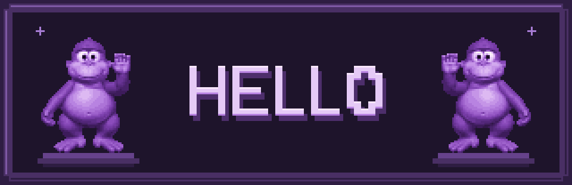
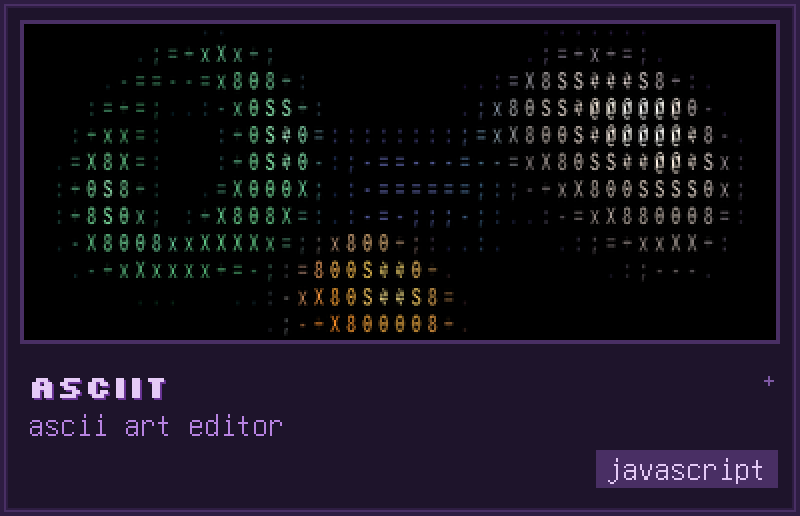
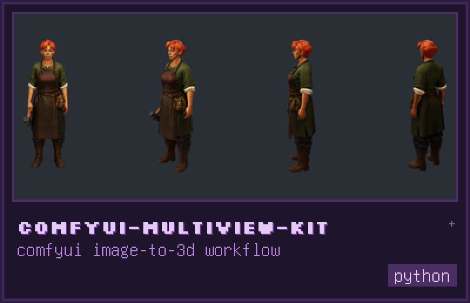
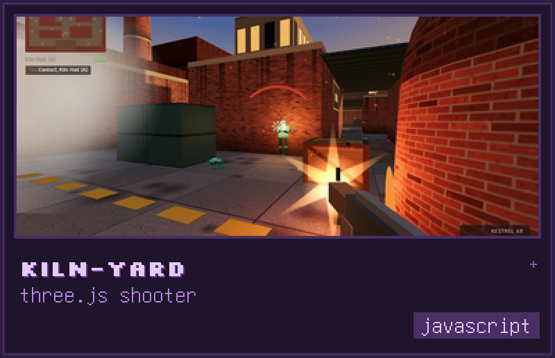
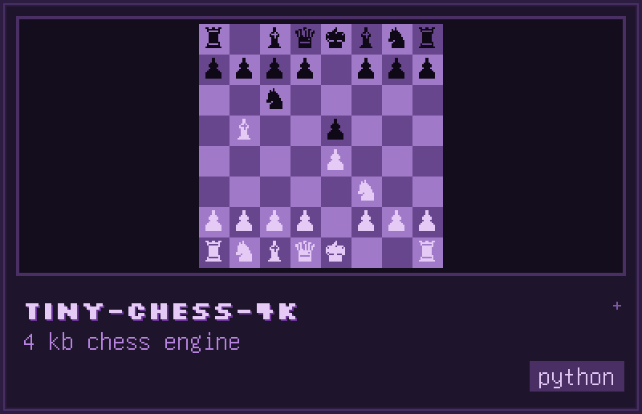

<h1 align="center">nabotz</h1>

  <picture>
    <source media="(prefers-reduced-motion: reduce)" srcset="assets/hello-centered-banner.png">
    
  </picture>

building stuff

  
  
   
  
  

**Usually working with:** TypeScript · Python · three.js / WebGL · Next.js · ComfyUI

**Say hi:** [X @sheluvbil](https://x.com/sheluvbil)
